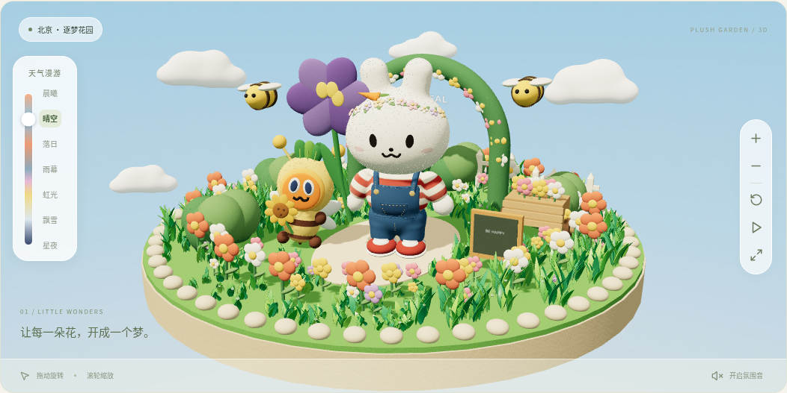
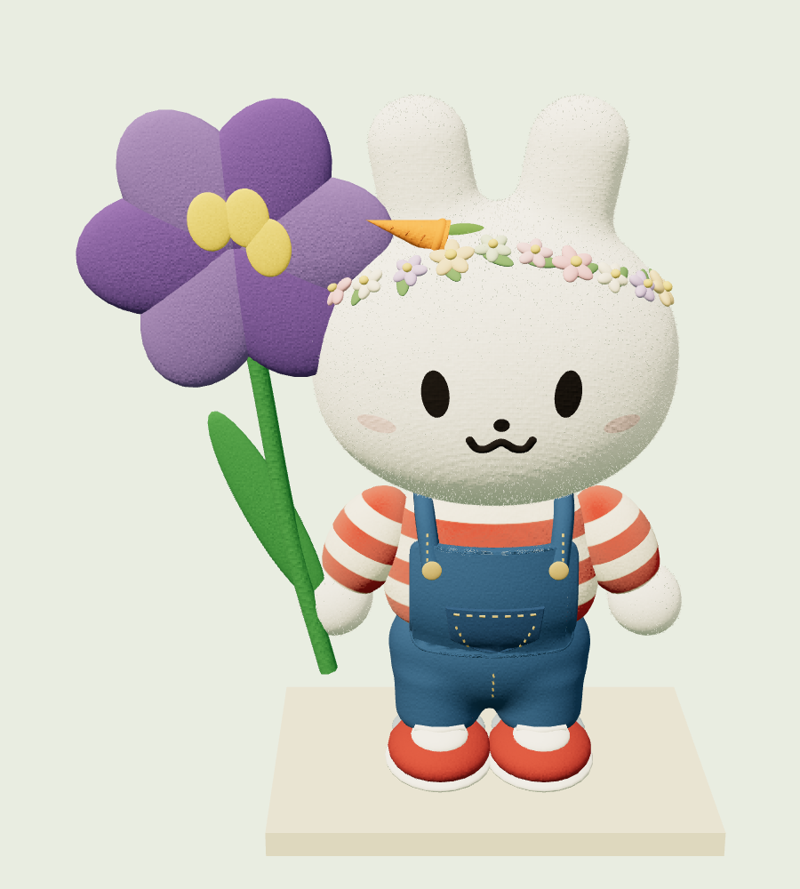
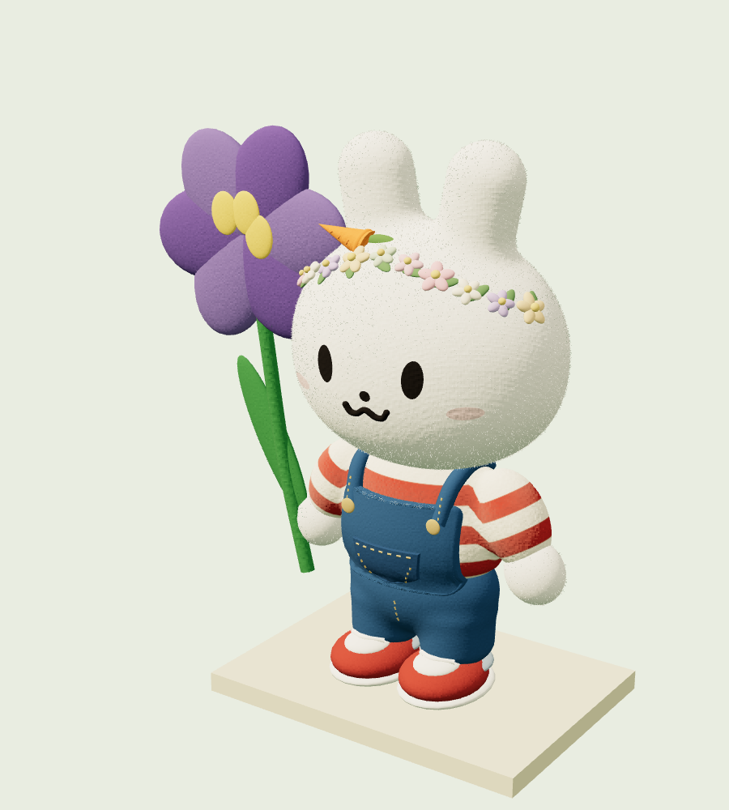
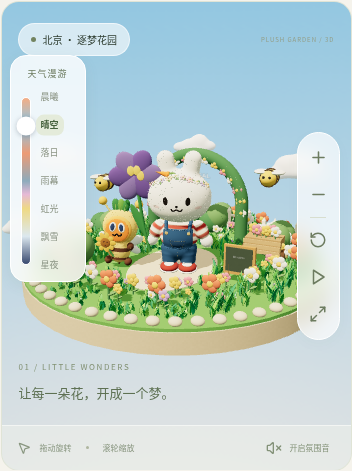

# 毛绒花园 · 实际效果

这里展示当前程序在浏览器中的实际渲染效果，区别于 [风格概念图](../concepts/README.md)。

兔子参考中间的毛绒概念图继续调整：上衣采用宽而平缓的领口，藏进下巴后面；下巴下方的白色衣边收窄，下面接红色条纹。裤腰、腰臀与短裤腿合成连续曲面，避免独立球体造成的分节感。保留实体公仔校准后的头部、花环、牛仔缝线和蜜蜂装胡萝卜。

第一个场景仍使用短绒纤维、布料纹理、毛毡花朵，地面升级为高低错落的鲜绿草丛、穿插小花与露珠。下面的模型近景与公园使用同一份 Three.js 模型代码。

天气控制已改为七种可选择的氛围，详见 [天气漫游实际截图](weather-tour.md)。兔子的上衣和袖子已融合成连续曲面，挥手时肩部跟随变形。

星夜下的花园会亮起暖色花灯，查看 [星夜发光花园实际截图](night-flowers.md)。

查看 [草地层次与露珠细节](living-meadow.md)，包含日景、夜景及手机实机截图。

## 花园实机截图

## 同一兔子模型的近景

## 肩部衔接调整前后

| 调整前 | 调整后 |
| --- | --- |
|  |  |

## 侧面衔接

## 手机页面

运行方式见 [项目说明](../../README.md)。鼠标拖动旋转、滚轮缩放，右侧工具可暂停动画和重置视角。
