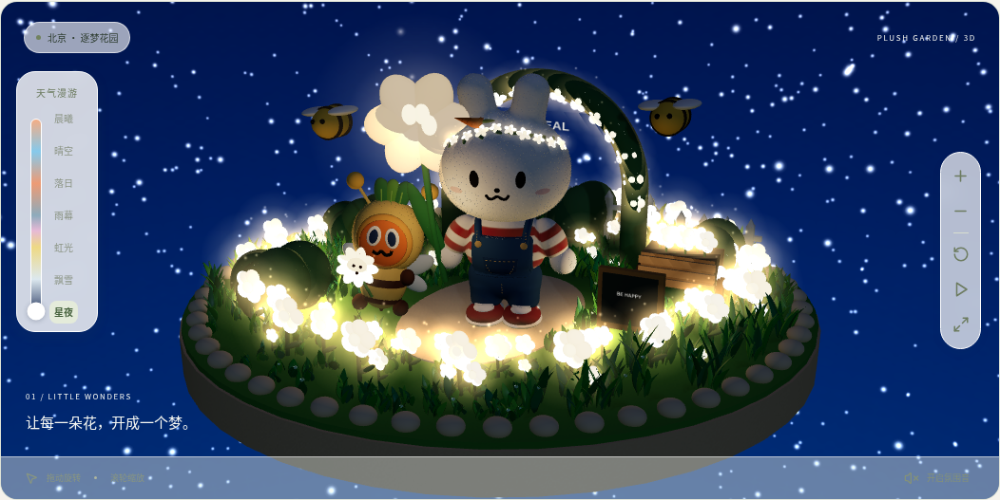
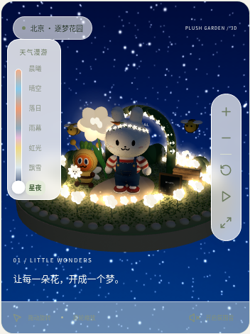

# 星夜 · 发光花园

在「逐梦花园」中选择左侧的「星夜」，花坛、拱门、花车、兔子花环以及角色手中的花都会逐渐亮起暖白、淡金色微光。花朵保留曲面明暗，周围有柔和光晕和轻轻漂浮的光点。

切回其他天气后，发光、光晕和暖色补光会平滑淡出。暂停动画时，光点与呼吸明暗会停止；天气切换仍然有效。

以下截图来自浏览器实际运行的 Three.js 场景。

## 花园夜景

## 手机效果

[返回天气漫游](weather-tour.md) · [返回花园截图](README.md)
