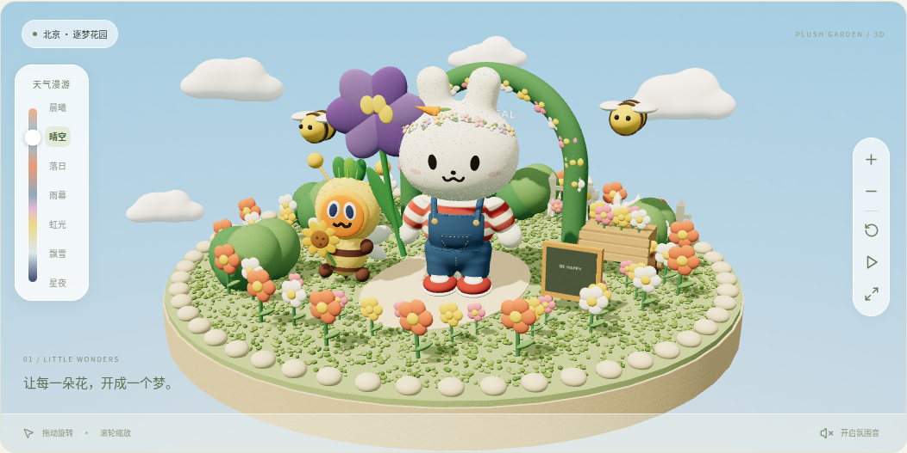
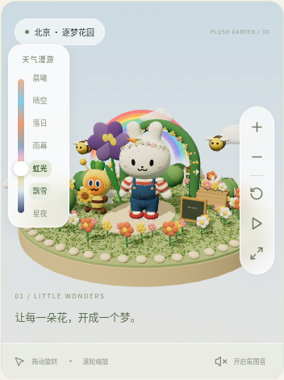

# 天气漫游 · 浏览器实际截图

天气滑杆是一组可以探索的氛围，不再代表一天的时间线。七个名称分别是晨曦、晴空、落日、雨幕、虹光、飘雪、星夜，原有的雨滴、雷电、彩虹、雪花、积雪与星空都保留。点击名称可直接选择，拖动滑杆仍会平滑过渡。

云朵改为连续的立体云团，使用不同轮廓和柔和的明暗，减少重复球体的接缝与堆叠。以下均来自当前 Three.js 程序，不是概念图。

## 晴空与新的天气选择器

## 飘雪

## 星空

花园里的花朵会随星夜渐亮，配有柔和光晕和漂浮光点。[查看发光花园大图与手机效果](night-flowers.md)。

## 手机上的虹光

[返回模型与花园截图](README.md)
